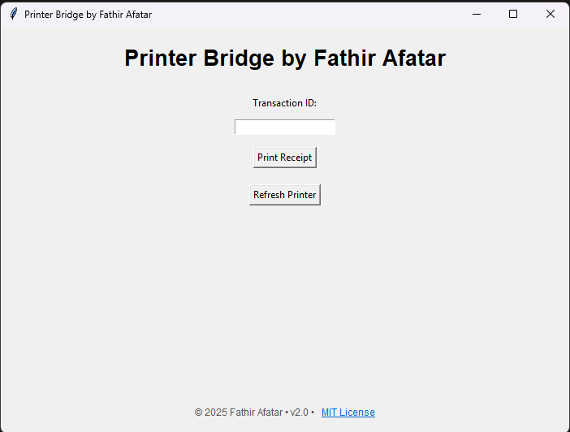
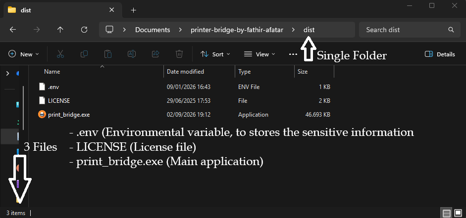
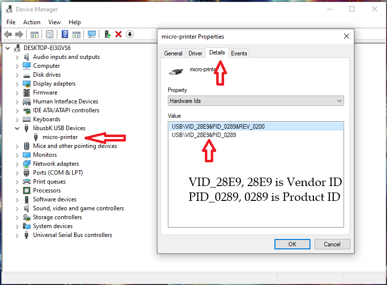
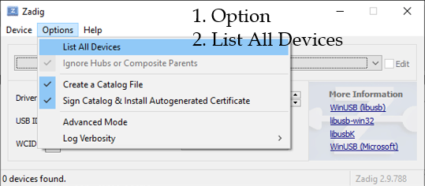
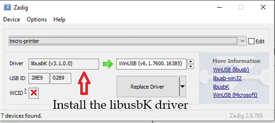

# Printer Bridge by Fathir Afatar


> Created by **Fathir Afatar**

A lightweight desktop middleware that bridges cloud-hosted web applications (Linux VPS) with local thermal receipt printers running on Windows.

---

## 📌 Overview

Connecting cloud-based web applications to local hardware like thermal printers is a common challenge in web development. **Printer Bridge** solves this by acting as a local listener on Windows. It fetches receipt payloads in JSON format from a remote VPS/Web URL and sends them directly to a local thermal printer for seamless printing.

---

## 📸 Preview



## 🔄 How It Works (Architecture)

```text
[ Web App / VPS (Linux) ]
          │
          │ Returns Receipt Data (JSON)
          ▼
[ Printer Bridge (Windows / Python + Flask) ] ◄── Configured via .env
          │
          │ Formats & Sends Command
          ▼
[ Local Thermal Printer ]
```
1. Configure the connection using a .env file (set `PRINTER_VENDOR_ID`, `PRINTER_PRODUCT_ID`, `PRINTER_NAME` and `VPS_URL`).

2. The local application listens for transaction input or incoming requests from the configured Web URL.

3. The remote web server responds with a standardized JSON payload containing receipt details.

4. Printer Bridge parses the JSON payload and outputs the physical receipt via the local thermal printer.


## ✨ Key Features
- Cross-Platform Bridging: Seamlessly links Linux VPS web applications with Windows local hardware.

- Lightweight & Fast: Minimal resource overhead, designed for instant printing upon entering transaction numbers.

- Environment Configurable: Easy setup using `.env` files for printer IDs and endpoints.

- JSON-Driven Interface: Uses standard JSON responses for easy integration with any backend stack.

- User-Friendly Interface: Built-in Tkinter GUI for easy configuration and status monitoring.

## 📄 JSON API Requirements
To ensure proper receipt formatting, your web application must return a JSON payload formatted strictly to match the expected receipt template structure.

> Example Expected Response:

```
  {
    "transaksi_id": 2998, 
    "tanggal": "12 September 2026 00:00", 
    "pembeli": "John", 
    "items": [
        {
            "nama_produk": "Coffee", 
            "jumlah": 1, 
            "harga_satuan": 103000.0, 
            "subtotal": 103000.0, 
            "diskon": null, 
            "catatan": null, 
            "is_paket": false
        }, 
        {
            "nama_produk": "Snacks", 
            "jumlah": 4, 
            "harga_satuan": 22000.0, 
            "subtotal": 88000.0, 
            "diskon": null, 
            "catatan": null, 
            "is_paket": false}, 
        {
            "nama_produk": "Rice", 
            "jumlah": 1, 
            "harga_satuan": 85000.0, 
            "subtotal": 85000.0, 
            "diskon": null, 
            "catatan": null, 
            "is_paket": false
            }], 
    "subtotal": 276000.0, 
    "status": "DRAFT", 
    "pengaturan": {
        "header": "Merchant name\r\n(address)\r\nTelp: (phone number)", 
        "footer": "Terimakasih", 
        "lebar_kertas": "58mm"
        }, 
    "total": 276000.0
    }
```
## 📁 Repository Structure
```
├── Images/            # UI screenshots and diagrams
├── local_escpos/      # Source from other repo
├── print_bridge.py    # Python file
├── printer.ico        # Icon for application
├── requirements.txt   # Required Python packages
├── LICENSE            # Open-source MIT License
└── README.md          # Project documentation
```

## 🚀 Getting Started
Prerequisites
- Python 3.x installed on a Windows machine.

- Thermal Printer drivers installed and configured locally.

## Installation & Setup

**Using the Relase version**
1. Create a .env file in the root directory based on this example:
```
PRINTER_VENDOR_ID=0x28E9
PRINTER_PRODUCT_ID=0x0289
PRINTER_NAME=Thermal58mm

VPS_URL=https://sample.domain
```
> Note: The `PRINTER_VENDOR_ID` and `PRINTER_PRODUCT_ID` is the thermal printer I use.

2. Run the app

```
print_bridge.exe
```

or

1. Clone the repository:

```
git clone https://github.com/Fathir-Afatar/Printer-Bridge-by-Fathir-Afatar.git
```
```
cd printer-bridge-by-fathir-afatar
```

3. Create a .env file in the root directory based on this example:
```
PRINTER_VENDOR_ID=0x28E9
PRINTER_PRODUCT_ID=0x0289
PRINTER_NAME=Thermal58mm

VPS_URL=https://sample.domain
```
> Note: The `PRINTER_VENDOR_ID` and `PRINTER_PRODUCT_ID` is the thermal printer I use.
4. Run the application (for testing):

```
python print_bridge.py
```

5. Note: The image below shows the file structure within a single folder required for the application to run.



6. To find out about `PRINTER_VENDOR_ID` and `PRINTER_PRODUCT_ID` we can use Device Manager like as shown below.



7. Install the Printer Thermal Driver



## 📄 Thermal Printer Specification
> This app working perfectly between my django project (running on VPS) and my thermal printing.


> Printer Thermal EPPOS PLUS 80mm POS80L - USB BLUETOOTH

| Name | Metric |
| :--- | :--- |
| Printing Method| Thermal line printing|
| Print columns | 384dots/lines|
| Character Set | ANK character |
| Font A | 12*24dots |
| Font B | 9*17dots |
| Jan/traditional form | 24*24dots |
| Barcode type | UPC-A/UPC-E/JAN13(EAN13)/JAN8(EAN8)/CODE39/ITF/CODABAR/CODE93/CODE128 |
| Auto-cutter | NO |
| Interface | USB+cashbox+Mullti-Bluetooth |
| Power | DC 9V/3A |
| Cashbox control | DC 12V/1A |
| Printing command | Compatible with `POS/ESC` command set |
| Paper Width | 80mm | 
| Temperature | 0~45ºC |
| Dampness | 10~80% |
| Paper thickness | 0.06~0.08mm |
| Max diameter of paper roll | 50mm |
| Weight | 339g |
| Dimension | 144 x 110 x 84 (W x H x D) |
| Drivers |  Win9X//Win10//Win11WinME/Win2000/WinNT/WinXP/Vista,compatible withEPSON,SAMSUNG |


## ⛔ Current Limitations
- Hardcoded Receipt Formatting: The current receipt layout structure is fixed to the initial version's schema and lacks dynamic template customization.

- JSON Dependency: Strictly requires the web application to output data matching the predefined JSON dictionary format.

- This "bridging" application enables a connection between a web application and a thermal printer using **only** the ESC/POS command set.

## 🗺️ Roadmap & Future Plans
[ ] Flexible & customizable receipt templating engine (e.g., Jinja2/custom layout builder).

[ ] Adding more command set (e.g., ZPL, TSPL, IPL, etc).

[ ] Support for dynamic logo rendering on receipts.

[ ] Auto-reconnect and retry queue for unstable network connections.

[ ] System tray minimizer support for background operation.

## 📄 License
This project is open-source and released under the [MIT License](/LICENSE). Free to use, modify, and distribute with attribution to Fathir Afatar.

## 💬 Contributing & Contact
Suggestions, bug reports, and enhancements are welcome!

- Open issues or submit pull requests on the GitHub Repository.

- If this tool helps solve your web-to-local printing issues, consider giving it a ⭐!